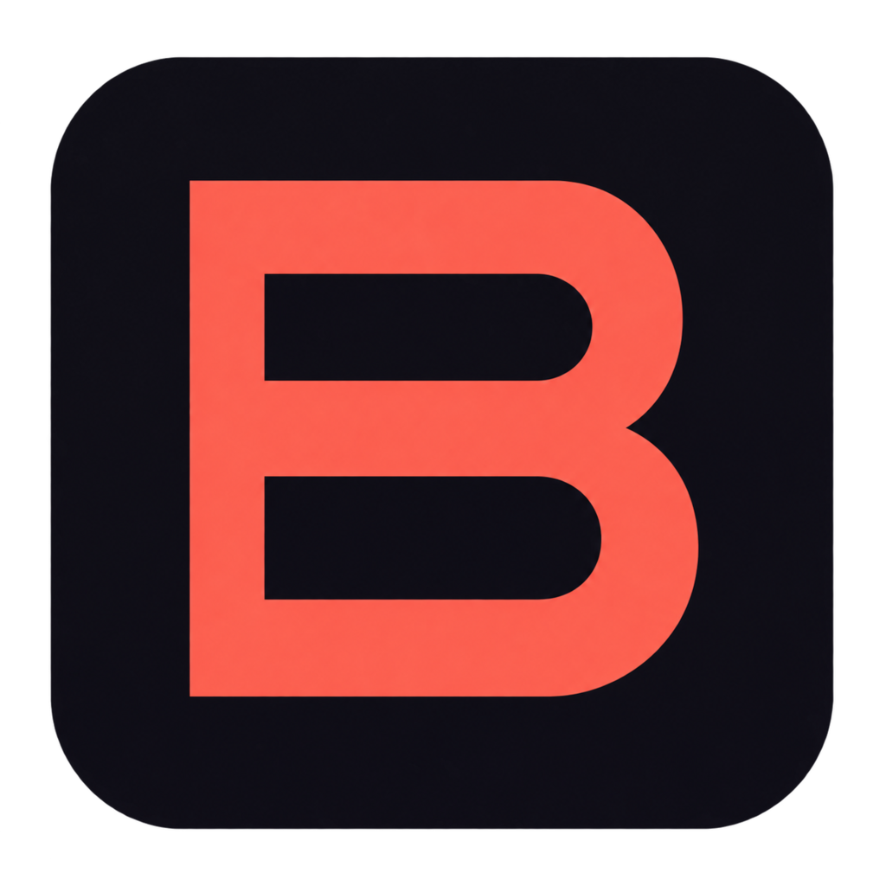
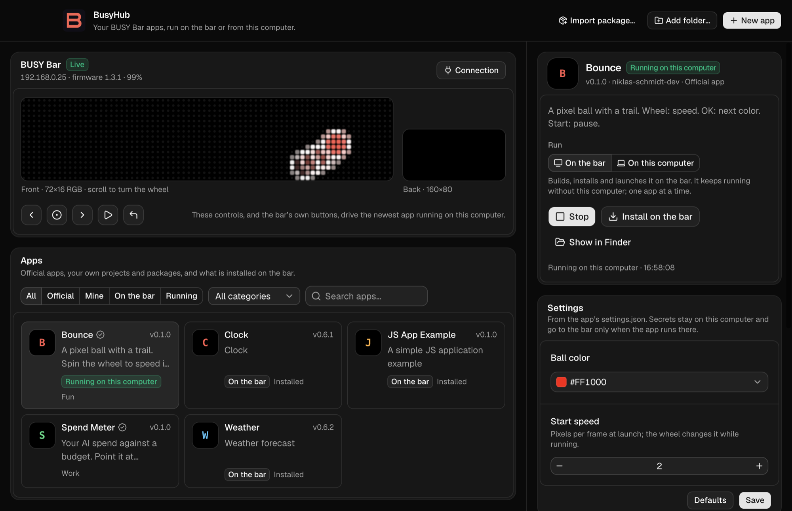

<p align="center">
  
</p>

<h1 align="center">BusyHub</h1>

<p align="center">
  <strong>Every app for your BUSY Bar, in one place.</strong><br />
  Install them from the catalog or write your own, then run each one on the bar or from your computer.
</p>

<p align="center">
  <a href="https://github.com/niklas-schmidt-dev/busyhub/releases/latest"></a>
  <a href="https://github.com/niklas-schmidt-dev/busyhub/actions/workflows/ci.yml"></a>
  
  <a href="LICENSE"></a>
</p>

<p align="center">
  <a href="#install">Install</a> ·
  <a href="#apps">Apps</a> ·
  <a href="#make-your-own-app">Make your own app</a> ·
  <a href="#add-your-app-to-the-catalog">Add your app to the catalog</a> ·
  <a href="#develop-busyhub">Develop</a>
</p>

<p align="center">
  
</p>

## What it does

- **One catalog.** Official apps from this repository, your own projects, `.tgz` packages, and the apps already installed on your bar, such as Clock and Weather.
- **Two ways to run.** On the bar, an app keeps running without your computer. From your computer, it can keep API keys off the bar, run in the background and run next to other apps.
- **Live view.** Both of the bar's screens are mirrored as they change. On-screen buttons and the wheel let you control an app without reaching for the bar.
- **Settings without code.** Every app's `settings.json` becomes a form. Fields marked secret stay on your computer.
- **Standard apps.** Every app is a normal [BUSY JS app](https://docs.busy.app/bar/dev/js-apps). BusyHub uses the official `busy-cli` and `busy-lib` and needs no fork of either.

## Install

BusyHub needs a BUSY Bar with **firmware 1.3.1 or newer**, the first release that runs JavaScript apps.

### macOS

```sh
curl -fsSL https://raw.githubusercontent.com/niklas-schmidt-dev/busyhub/main/install.sh | sh
```

The script installs BusyHub to `/Applications` (or `~/Applications`) and opens it. You can also download it yourself: [Apple silicon](https://github.com/niklas-schmidt-dev/busyhub/releases/latest/download/BusyHub-mac-arm64.dmg) · [Intel](https://github.com/niklas-schmidt-dev/busyhub/releases/latest/download/BusyHub-mac-x64.dmg).

> [!NOTE]
> Releases are not notarized by Apple yet. If you install from the `.dmg` and macOS refuses to open BusyHub, open **System Settings → Privacy & Security** and choose **Open Anyway**. The install script does that step for you.

### Windows

```powershell
irm https://raw.githubusercontent.com/niklas-schmidt-dev/busyhub/main/install.ps1 | iex
```

Or download the installer: [x64](https://github.com/niklas-schmidt-dev/busyhub/releases/latest/download/BusyHub-windows-x64-setup.exe) · [Arm](https://github.com/niklas-schmidt-dev/busyhub/releases/latest/download/BusyHub-windows-arm64-setup.exe). It installs for your user and needs no administrator rights. The installer is not code-signed yet, so SmartScreen may ask once: choose **More info → Run anyway**.

### Linux

```sh
curl -fsSL https://raw.githubusercontent.com/niklas-schmidt-dev/busyhub/main/install.sh | sh
```

On Debian and Ubuntu the script installs the `.deb` package (it asks for `sudo`). Anywhere else it puts the AppImage in `~/.local/bin` and adds BusyHub to your app menu. Downloads: [.deb x64](https://github.com/niklas-schmidt-dev/busyhub/releases/latest/download/BusyHub-linux-amd64.deb) · [.deb Arm](https://github.com/niklas-schmidt-dev/busyhub/releases/latest/download/BusyHub-linux-arm64.deb) · [AppImage x64](https://github.com/niklas-schmidt-dev/busyhub/releases/latest/download/BusyHub-linux-x86_64.AppImage) · [AppImage Arm](https://github.com/niklas-schmidt-dev/busyhub/releases/latest/download/BusyHub-linux-arm64.AppImage).

### Connect your bar

BusyHub looks for the bar at `10.0.4.20`, its address over **USB**, where no password is needed. To use **Wi-Fi**, open the bar's web settings, turn on **HTTP API → HTTP API access**, then enter the bar's address in **Connection**. If **Password protection** is on, enter that password too. BusyHub encrypts it with your system keychain.

## Apps

These apps come with BusyHub. Each one is a folder in [`apps/`](apps):

<!-- apps:start -->
| App | What it does | Runs on | By |
| --- | --- | --- | --- |
| [**Bounce**](apps/bounce) | A pixel ball with a trail. Spin the wheel to speed it up. | Bar · Computer | [@niklas-schmidt-dev](https://github.com/niklas-schmidt-dev) |
| [**Spend Meter**](apps/spend-meter) | Your AI spend against a budget. Point it at Passcard's read API. | Computer · Bar | [@niklas-schmidt-dev](https://github.com/niklas-schmidt-dev) |
<!-- apps:end -->

Apps added to the catalog ship with the next BusyHub release. You don't need the catalog to run something, though: anything you build or download runs locally just the same.

## Make your own app

1. Click **New app** and give it a name. BusyHub creates a project in `Documents/BusyHub/apps`, starting from a template that already has settings, wheel input and storage.
2. Open the folder, edit `src/main.ts`, and press **Run**. Choose **On the bar** or **On this computer**.

You can also **Add folder…** for an app that lives somewhere else, such as a project made with `npm create @busy-app/app` or a folder of several apps. BusyHub links it where it is and picks up changes on its own. **Import package…** adds an app someone sent you as a `.tgz`.

Running an app from source needs [Node.js 24+](https://nodejs.org) once, to install the project's dependencies. BusyHub builds with its own copy of Node after that. Official apps and `.tgz` packages need no Node at all.

| | On the bar | On this computer |
| --- | --- | --- |
| Keeps running without your computer | ✓ | |
| API keys stay off the bar | | ✓ |
| Several apps at once | One at a time | ✓ |
| Reaches services on your computer, e.g. `localhost:3000` | | ✓ |
| Reads the bar's buttons | ✓ | ✓ |

An optional `hub.json` next to `package.json` sets how the catalog shows an app:

```json
{
  "category": "Fun",
  "tagline": "A pixel ball with a trail. Spin the wheel to speed it up.",
  "accent": "#FF5A4F",
  "modes": ["device", "host"]
}
```

`modes` lists where the app can run: `device` is the bar, `host` is your computer. The first one is the default.

## Add your app to the catalog

Built something others would enjoy? Fork this repository, copy your app into `apps/<name>`, and open a pull request. CI checks the app and builds it, and a maintainer reviews it. Once merged, it ships with the next release for everyone. [CONTRIBUTING.md](CONTRIBUTING.md) has the steps and the catalog rules.

## Develop BusyHub

```sh
git clone https://github.com/niklas-schmidt-dev/busyhub.git
cd busyhub
pnpm install
pnpm dev
```

| Command | Does |
| --- | --- |
| `pnpm dev` | BusyHub with hot reload; official apps are built from `apps/` |
| `pnpm typecheck` · `pnpm test` | Types and unit tests |
| `pnpm apps:check` | Checks every app in `apps/` against the catalog rules |
| `pnpm dist` | Installers for your platform in `release/` |

<details>
<summary><strong>How it works</strong></summary>

```
src/main/        Electron main process
  hub.ts         the catalog, the bar connection, and every run on the bar or on this computer
  catalog.ts     finds official apps, your folders and packages; merges the bar's own app list
  bar.ts         busy-lib client, plus app launch and quit
  builder.ts     runs the project's busy-cli on BusyHub's own Node
  host-worker.ts the runtime for an app that runs on your computer
  config.ts      bar address, encrypted password and settings
src/preload/     the typed bridge to the window
src/renderer/    the interface: React, shadcn/ui, ReUI
src/shared/      types and logic shared by both sides
apps/            the official catalog
templates/       the starter for New app
scripts/         catalog checks, the official apps build, this README's apps table
```

**On the bar**, BusyHub builds the app with `busy-cli`, uploads the package through the bar's HTTP API and launches it.

**On your computer**, BusyHub runs the same build in a worker thread and recreates what the bar's JavaScript runtime gives an app:
- requests to `localhost` (the bar's own API) go to your bar, with its password;
- `listen('input', …)` receives the bar's buttons and the on-screen controls;
- settings come from BusyHub;
- `localStorage` is a file.

</details>

## Security and limits

- An app running on your computer has your user's permissions. Official apps are reviewed before they are merged; run anything else only when you trust it.
- The window's content security policy allows `'unsafe-eval'`, because busy-lib's live-view worker decodes the bar's data with generated code. The window loads only BusyHub's own bundled code and shows app data as plain text.
- The bar's own buttons reach an app running on your computer through the bar's state stream. Whatever the bar shows at the time sees the same presses.
- BusyHub only knows an app is running on the bar if it launched it there. If you quit the app on the bar itself (hold Back), BusyHub still shows it as running.
- Releases are not yet signed by Apple or Microsoft, and there are no automatic updates yet.

Found a security problem? See [SECURITY.md](SECURITY.md).

## Acknowledgements

BusyHub is an independent community project. It is not affiliated with or endorsed by BUSY or Flipper Devices. It builds on [busy-lib and busy-cli](https://github.com/busy-app), [Electron](https://www.electronjs.org), [shadcn/ui](https://ui.shadcn.com) and the free [ReUI](https://reui.io) components; see [THIRD_PARTY_NOTICES.md](THIRD_PARTY_NOTICES.md).

## License

[MIT](LICENSE) © 2026 Niklas Schmidt and contributors
